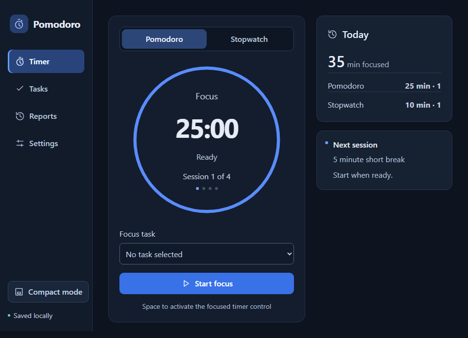

# Pomodoro Timer

[](https://github.com/imranpollob/pomodoro-timer/actions/workflows/ci.yml)

Pomodoro Timer 1.0.0 is a focus timer for Windows, macOS and Linux, built with Tauri 2, Rust, Svelte/TypeScript and SQLite. Sessions, tasks and settings are stored in a local profile.



## Features

- Pomodoro, short/long breaks and stopwatch, with precise pause/resume and explicit finish confirmation.
- A 200 × 44 compact countdown strip with one play/pause button and a keyboard-accessible menu for other actions.
- Tasks that you assign before a session starts; the title is saved with the session.
- Reports for today, the last 7/30 days and custom date ranges.
- System tray (Windows/Linux) or menu bar (macOS, showing the running time), native notifications and audio, light/dark theme.
- Windows lock/suspend pause handling, transactional SQLite storage, and regular checkpoints managed by one Rust timer service.

## Install

Download the unsigned NSIS installer for Windows, `.dmg` for macOS, or `.deb` for Linux from the [v1.0.0 GitHub release](https://github.com/imranpollob/pomodoro-timer/releases/tag/v1.0.0). The earlier Python app is available as [`v0.3.1`](https://github.com/imranpollob/pomodoro-timer/releases/tag/v0.3.1). See the [platform record](docs/implementation/platform-validation.md) for verified behavior and outstanding checks. Coming from the Python app? See [MIGRATION.md](MIGRATION.md).

## Build from source

Install the [Tauri prerequisites](https://v2.tauri.app/start/prerequisites/), Rust via rustup (the toolchain is pinned in `rust-toolchain.toml`) and Node 24 (see `.node-version`).

```sh
npm ci
npm run dev      # run the app
npm run build    # build for the current operating system
```

The build command packages for the current operating system; it does not create Windows, macOS and Linux packages together. See the [development guide](docs/development.md#local-packages) for local `.dmg`, `.exe` and `.deb` instructions.

## Data and privacy

Profiles live in the app-data directory for `com.imranpollob.pomodoro-timer`. Set `POMODORO_DATA_DIR` before launching to use another location. Back up the whole directory with the app closed.

## Project layout

| Path | Purpose |
| --- | --- |
| `crates/focus-core/` | Timer domain, service and SQLite persistence (no Tauri dependency) |
| `src-tauri/` | Windows, tray, notifications, audio and process lifecycle |
| `src/` | Svelte views and typed IPC client |
| `tests/` | Playwright UI tests |
| `scripts/` | Smoke tests, demo seeder and packaging helpers |
| `docs/` | Development guide, specifications and validation records |

## Contributing

See [CONTRIBUTING.md](CONTRIBUTING.md) and [SECURITY.md](SECURITY.md).
